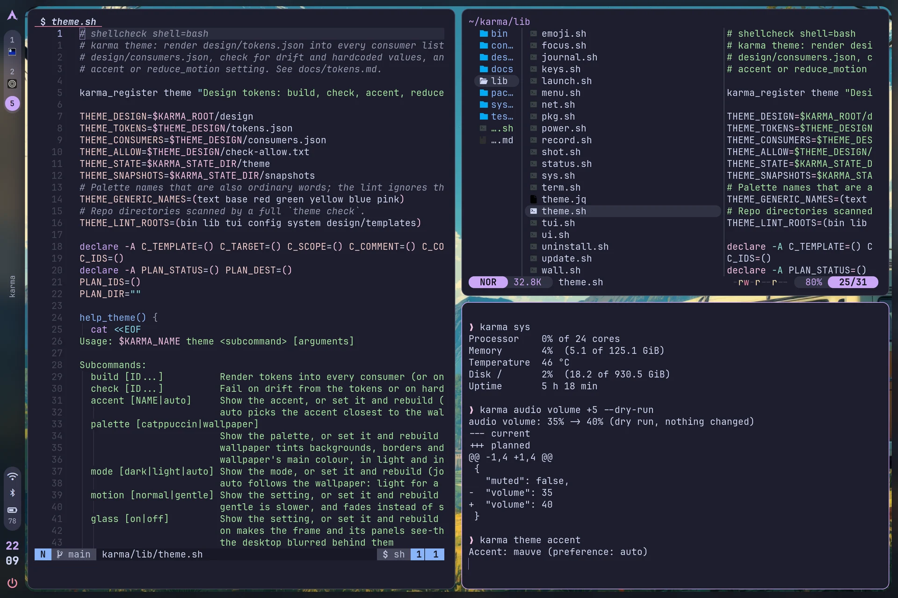
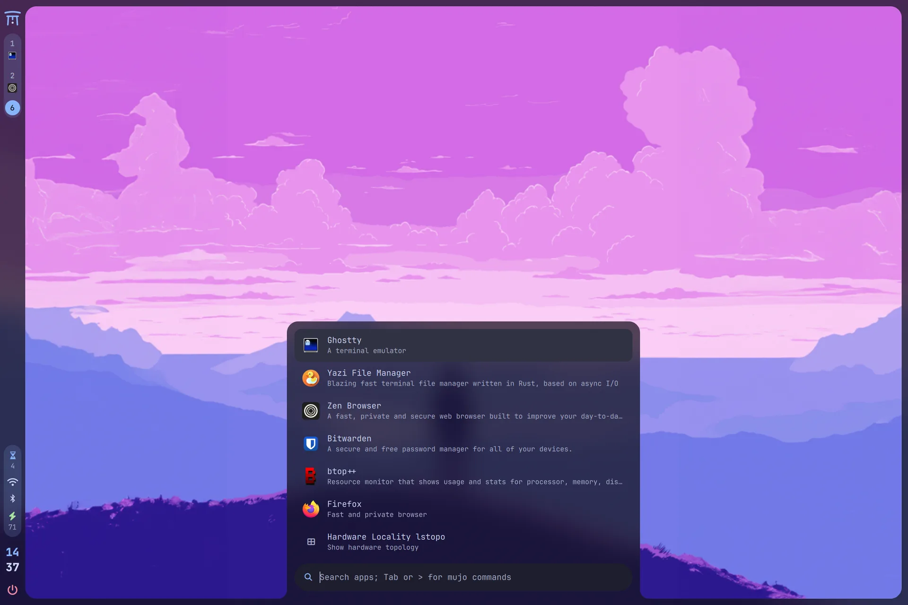
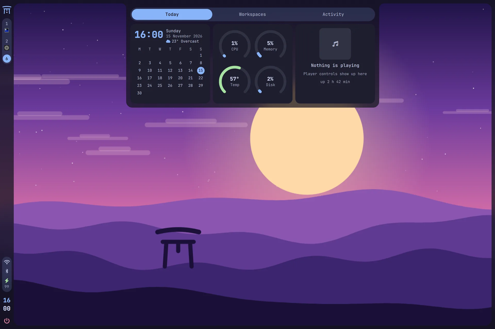
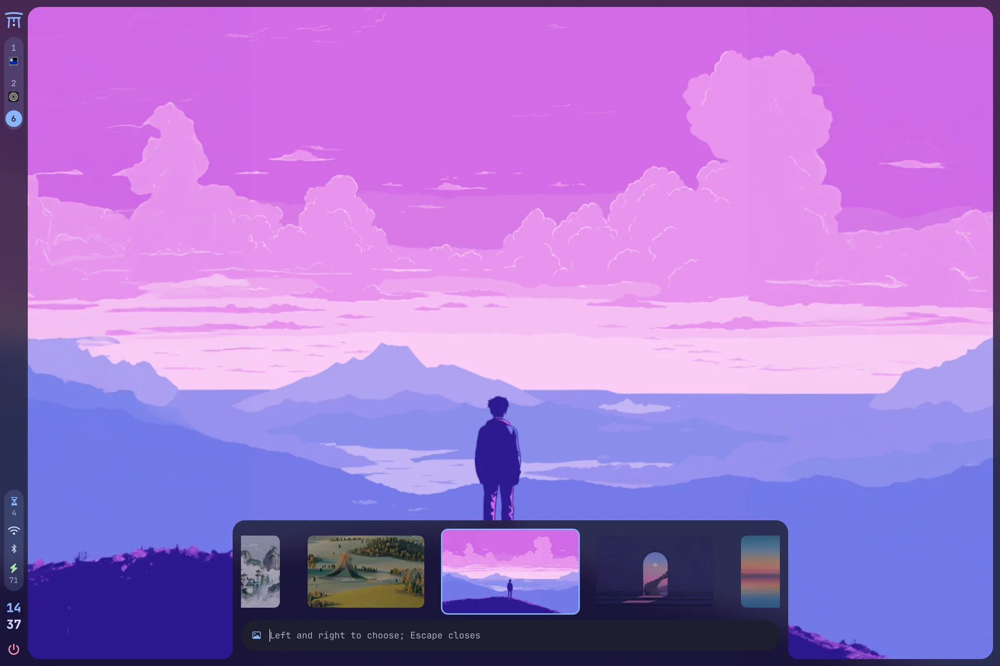
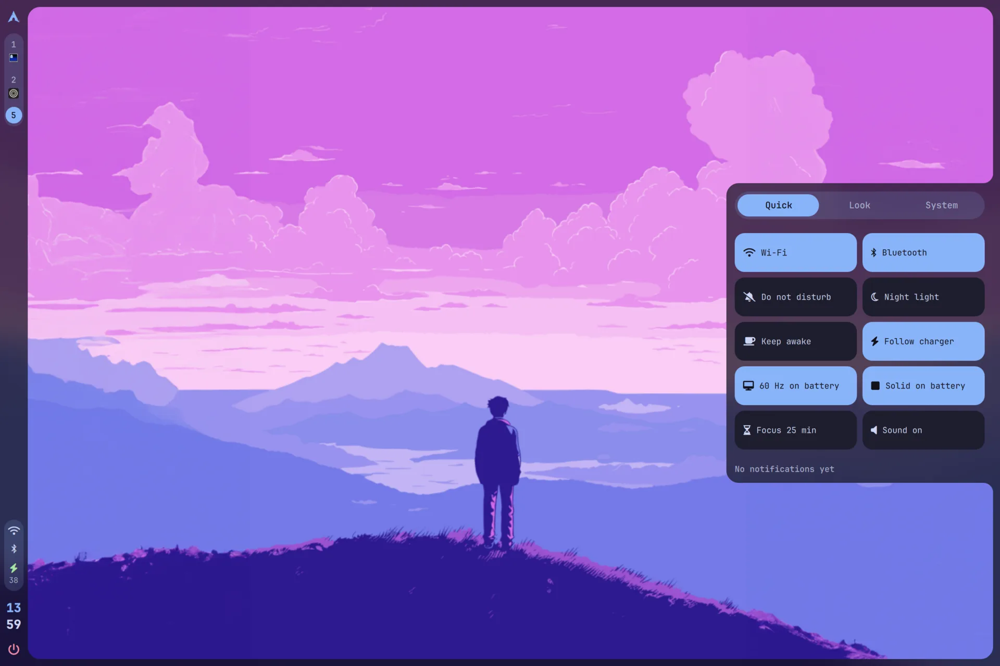

<p align="center">
  <picture>
    <source media="(prefers-color-scheme: dark)" srcset="docs/logo/mark-dark.svg">
    
  </picture>
</p>

<h1 align="center">mujo</h1>

<p align="center">
  <b>A terminal-first desktop for Arch Linux where every change can be previewed, is written down, and can be undone.</b>
</p>

<p align="center">
  Hyprland (Lua config) · Quickshell · one <code>mujo</code> command · Catppuccin
</p>

<p align="center">
  <a href="#install">Install</a> ·
  <a href="#a-quick-tour">Tour</a> ·
  <a href="#everything-is-a-command">CLI</a> ·
  <a href="#one-theme-everywhere">Theme</a> ·
  <a href="#docs">Docs</a>
</p>



## Why mujo

Most desktop setups are a pile of configs and a bar that shells out to a dozen
tools. mujo puts one command in the middle. The volume keys, the quick-settings
sliders, the launcher and you at a prompt all go through `mujo`, so the desktop
behaves the same wherever a change comes from.

- **See it first.** `--dry-run` on any command prints what would change and changes nothing.
- **Take it back.** Changes are journaled with the state before and after. `mujo undo` reverts the last one; actions that cannot be undone say so and ask for `--yes`.
- **Works without the screen.** Everything that does not need Wayland runs over SSH or on a TTY, and `--json` gives scripts stable output.
- **One source for the look.** Colours, sizes, fonts and durations live in one file and are rendered into 14 programs, from the bar to the login screen.
- **Updates you can walk back.** `mujo update` takes a snapshot before and after when snapper covers `/`, and `mujo update rollback` returns the system files to the earlier one.
- **Leaves cleanly.** The installer backs up what it replaces, and `mujo uninstall` restores it.

## A quick tour

A frame runs around the screen with a bar on the left. Panels grow out of that
frame instead of floating over your windows.

| | |
| --- | --- |
|  **Launcher** `SUPER + Space`<br>Apps, every mujo command (`>`), a calculator (`=`), clipboard, emoji, Wi-Fi |  **Dashboard** `SUPER + D`<br>Calendar, system gauges, media, weather |
|  **Wallpapers** `SUPER + Shift + W`<br>Moving along the strip applies the image; light or dark and the accent follow it |  **Keybindings** `SUPER + /`<br>Every bind with its description; pick one to run it |
|  **Power menu** `SUPER + Shift + Escape` |  **Quick settings** `SUPER + A`<br>Wi-Fi, Bluetooth, night light, power and battery options, notification history |

Also in the box:

- **About card** (click the logo in the bar, or `mujo about`): the machine at a glance, the health check, pending updates, and the latest changes with an undo button next to each.
- **Workspace overview** (`SUPER + Tab`) with live pictures of the windows.
- **Lock screen** with password or fingerprint, and media controls.
- **Screenshots and recording**: an area picker on `Print`, `mujo record`, and `mujo shot text` to copy text out of any part of the screen.
- **Battery care**: a charge limit, a power profile that follows the charger, and 60 Hz with solid panels while on battery.
- **Drop-down terminal** (``SUPER + ` ``), a focus timer, and a pending-updates count in the bar.
- **A terminal toolkit that matches**: Ghostty, zsh, tmux, Neovim, yazi, btop and fzf, all themed from the same tokens.

## Install

> [!IMPORTANT]
> mujo is for **Arch Linux** and replaces your Hyprland config and, if you agree, your login screen. Run the dry run first. It has been used daily on one machine (a Framework 13, AMD); other hardware and multi-monitor setups are less tested.

```sh
git clone https://github.com/zoix/mujo ~/.local/share/mujo
cd ~/.local/share/mujo
./install.sh --dry-run    # the full plan; changes nothing and needs no sudo
./install.sh              # a few questions, the plan, one confirmation
```

Then reboot: greetd starts on tty1 and logs you into Hyprland.

- Existing configs are backed up to `~/.local/state/mujo/backups/` before anything is replaced.
- Nothing is removed without you agreeing to it, and `--skip-system` keeps the installer inside `$HOME`.
- Running it again with the same answers changes nothing.

Flags, the order of steps and what happens to an existing `hyprland.conf`:
[docs/install.md](docs/install.md).

## Everything is a command

```sh
mujo status                  # audio, network, display, theme, battery
mujo audio volume +5         # every change is journaled...
mujo undo                    # ...and can be put back
mujo log                     # what changed, and when
mujo net tui                 # pick a Wi-Fi network
mujo power reboot --dry-run  # see what an action would do
mujo pkg install             # search the repos and the AUR with fzf
mujo doctor                  # is everything in place?
mujo update                  # mujo and the system, with snapshots
mujo update rollback --yes   # put the system back as it was before that update
```

`mujo help` lists all 31 commands; the full reference is in
[docs/cli.md](docs/cli.md).

| Keys | Opens |
| --- | --- |
| `SUPER + Return` | Terminal |
| `SUPER + Space` | Launcher |
| `SUPER + A` | Quick settings and notification history |
| `SUPER + Tab` | All workspaces at a glance |
| `SUPER + D` | Dashboard |
| `SUPER + V` | Clipboard history |
| `SUPER + Escape` | Lock |
| `SUPER + /` | All keybindings |

All keys: [docs/keybinds.md](docs/keybinds.md).

## One theme, everywhere

`design/tokens.json` is the only place a colour, size, font or duration is
written. `mujo theme build` renders it into Quickshell, Hyprland, Ghostty,
tmux, btop, yazi, fzf, zsh, GTK 3 and 4, the greetd login screen and the
console palette. `mujo theme check` fails if any of them drifts.

```sh
mujo theme mode auto          # light or dark, following the wallpaper
mujo theme accent auto        # the accent closest to the wallpaper's colour
mujo theme palette wallpaper  # tint the whole palette with the wallpaper
mujo theme glass on           # see-through panels with the desktop blurred behind
mujo theme motion gentle      # slower, fades instead of slides
mujo theme reduce-motion on   # no animation at all
```

Put your wallpapers in `~/Pictures/Wallpapers`. How tokens and templates work:
[docs/tokens.md](docs/tokens.md).

## How it fits together

Two layers with a strict split: **the core decides, Quickshell presents.** The
interface never calls `nmcli`, `wpctl` or `hyprctl` to change anything; it runs
`mujo <command> --json`, and the core plans, applies and records.

```
 Terminal / TTY / SSH      Floating TUIs          Quickshell UI
   mujo <command>      launcher, menu, Wi-Fi   bar, panels, notifications
          \                    |                    /
           v                   v                   v
          +-----------------------------------------+
          |             mujo core (CLI)             |
          |         plan -> apply -> record         |
          +-----------------------------------------+
             |                 |                 |
       Action journal     Design tokens    System services
       log and undo       theme build      wpctl, nmcli, hyprctl
```

More in [docs/architecture.md](docs/architecture.md).

## Remove

```sh
mujo uninstall --dry-run     # shows the plan
mujo uninstall --yes         # removes mujo's links and restores the backups
```

Packages the installer removed at your request are not reinstalled.

## Develop

The core is Bash and jq, the interface is QML, and the tests run against test
doubles, so they never touch your audio, network or packages.

```sh
tests/lint.sh    # shellcheck, bats, theme check, Lua and zsh syntax, qmllint
```

To try the theme engine without touching your config:

```sh
export XDG_CONFIG_HOME=$(mktemp -d) XDG_STATE_HOME=$(mktemp -d)
bin/mujo theme build && bin/mujo theme check
```

Issues and pull requests are welcome. For anything larger than a fix, open an
issue first so we can agree on the shape.

## Docs

- [Architecture](docs/architecture.md)
- [Installing](docs/install.md)
- [Keybindings](docs/keybinds.md)
- [CLI reference](docs/cli.md)
- [Design tokens and templates](docs/tokens.md)
- [Neovim](docs/neovim.md) · [tmux](docs/tmux.md)

## Thanks

mujo stands on [Hyprland](https://hypr.land), [Quickshell](https://quickshell.org),
[Catppuccin](https://catppuccin.com) and [Ghostty](https://ghostty.org).

## License

[MIT](LICENSE)
