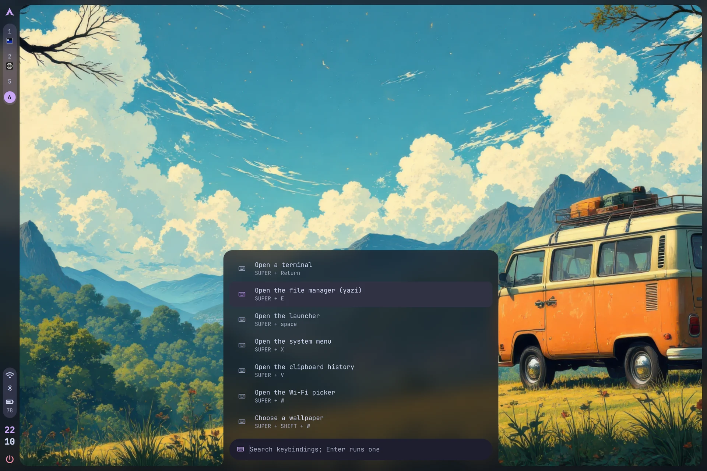
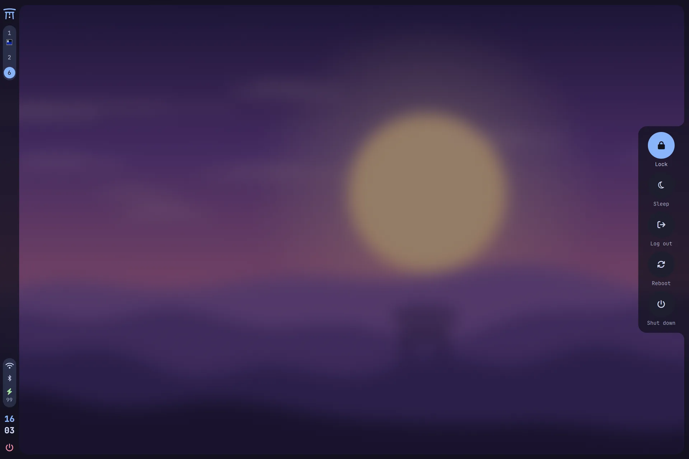

# mujo

A terminal-first desktop for Arch Linux: Hyprland (Lua config), a Quickshell
interface and a `mujo` CLI that owns every change to the system, with
dry runs, a journal and undo. Catppuccin Mocha (dark) or Latte (light), chosen from the wallpaper; one accent.
Optionally the whole palette is tinted with the wallpaper's colour.


| | |
| --- | --- |
|  Launcher, `SUPER + Space` |  Dashboard, `SUPER + D` |
|  Wallpapers, `SUPER + Shift + W` |  Keybindings, `SUPER + /` |
|  Power menu, `SUPER + Shift + Escape` | |

**Status: phase 4 (complete).** `install.sh` sets up Hyprland with the mujo
look, Ghostty, a themed zsh, greetd with tuigreet and the console
palette. The `mujo` CLI controls audio, Wi-Fi, Bluetooth, brightness, night
light, wallpaper, theme, power, screenshots and the clipboard, and every
change can be previewed, is journaled and can be undone. The Quickshell
interface draws a frame around the screen with a bar on the left; the
launcher, the power menu, notifications and the volume display grow out of
that frame. Light or dark and the accent colour follow the wallpaper.

## Install

```sh
./install.sh --dry-run    # see everything it would do; changes nothing
./install.sh              # a few questions, the plan, one confirmation
```

Then reboot: greetd starts on tty1 and logs you into Hyprland.
Existing configs are backed up to `~/.local/state/mujo/backups/` first.
Details, flags and what happens to an existing `hyprland.conf`:
[docs/install.md](docs/install.md).

## Use

| Keys | Opens |
| --- | --- |
| `SUPER + Space` | Launcher; type `>` for every mujo command |
| `SUPER + A` | Quick settings and notification history |
| `SUPER + Tab` | All workspaces at a glance |
| `SUPER + D` | Dashboard: calendar, system gauges, media |
| `SUPER + Shift + W` | Wallpaper strip; moving along it applies the image |
| `SUPER + Shift + Escape` | Power menu |
| `SUPER + Escape` | Lock |
| `SUPER + /` | All keybindings |

Everything is also a command, and works over SSH or on a TTY except what
needs the screen:

```sh
mujo status                  # audio, network, display, theme, battery
mujo audio volume +5         # every change is journaled...
mujo undo                    # ...and can be put back
mujo log                     # what changed
mujo net tui                 # pick a Wi-Fi network
mujo theme mode light        # or dark, or auto (follow the wallpaper)
mujo theme accent blue       # or auto
mujo power reboot --dry-run  # see what an action would do
mujo doctor                  # is everything in place?
mujo update                  # mujo and the system
```

Put your wallpapers in `~/Pictures/Wallpapers`. All keys:
[docs/keybinds.md](docs/keybinds.md). All commands: [docs/cli.md](docs/cli.md).

## Remove

```sh
mujo uninstall --dry-run     # shows the plan
mujo uninstall --yes         # restores what install.sh backed up
```

## Develop

```sh
tests/lint.sh    # shellcheck, bats, theme check, Lua and zsh syntax, qmllint
```

To try the theme engine without touching your config:

```sh
export XDG_CONFIG_HOME=$(mktemp -d) XDG_STATE_HOME=$(mktemp -d)
bin/mujo theme build && bin/mujo theme check
```

## Docs

- [Architecture](docs/architecture.md)
- [Installing](docs/install.md)
- [Keybindings](docs/keybinds.md)
- [Design tokens and templates](docs/tokens.md)
- [CLI reference](docs/cli.md)
- [Neovim](docs/neovim.md)
- [tmux](docs/tmux.md)
